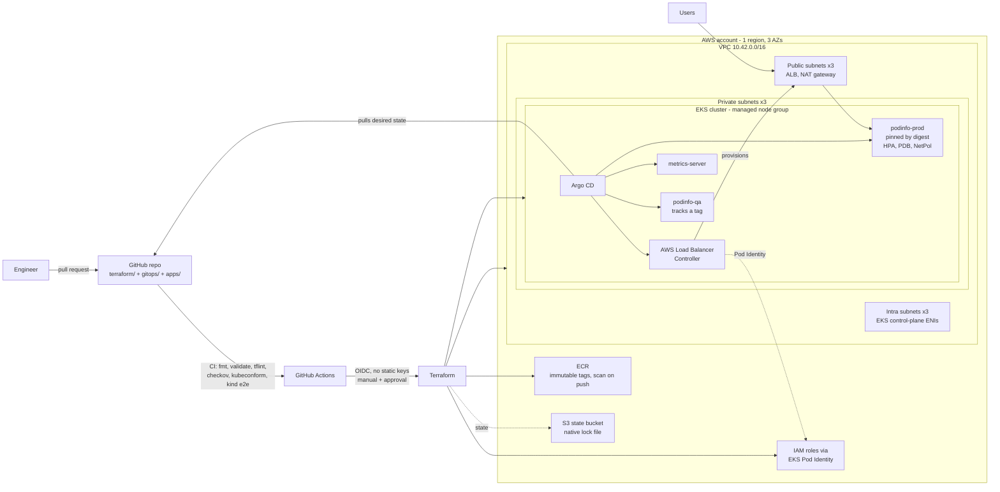
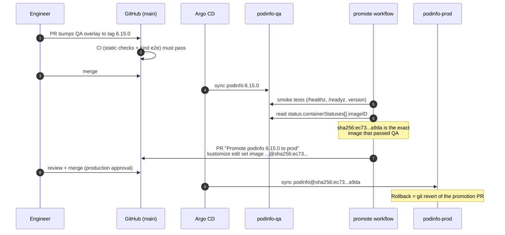

# AWS EKS GitOps Platform

[](https://github.com/rsk071216-stack/aws-eks-gitops-platform/actions/workflows/ci.yml)


A production-shaped reference platform for running containerised services on
**Amazon EKS with GitOps**. Terraform builds a hardened, multi-AZ EKS
foundation (Pod Identity, access entries, network policy, immutable ECR).
Argo CD continuously reconciles add-ons and workloads from Git. Releases follow
**build once, promote by digest**: prod only ever runs the exact image bytes
that passed QA, and every production change is a reviewed pull request.
Every commit is tested end to end on a real Kubernetes cluster in CI, with no
cloud credentials required.

---

## Table of contents

- [The problem this solves](#the-problem-this-solves)
- [Architecture](#architecture)
- [Key features](#key-features)
- [What makes this different](#what-makes-this-different)
- [Repository layout](#repository-layout)
- [Quick start without an AWS account](#quick-start-without-an-aws-account)
- [Full AWS deployment](#full-aws-deployment)
- [Cost estimate](#cost-estimate)
- [Security](#security)
- [Design decisions](#design-decisions)
- [What CI verifies vs. what needs a real AWS account](#what-ci-verifies-vs-what-needs-a-real-aws-account)
- [How I can apply this to your team](#how-i-can-apply-this-to-your-team)
- [Roadmap](#roadmap)

---

## The problem this solves

Most teams that move to Kubernetes end up with the same pain points:

| Pain | Business impact | How this platform addresses it |
|------|-----------------|--------------------------------|
| "It worked in QA" - but prod runs a different build | Outages, failed audits, lost trust | Prod is pinned to the **image digest verified in QA**; tags cannot sneak in |
| Deployments run from laptops or ad-hoc scripts | No audit trail, knowledge locked in one person | **Git is the only way to change a cluster**; Argo CD applies and self-heals |
| Long-lived AWS keys in CI and in pods | The most common cause of cloud breaches | **GitHub OIDC** for CI, **EKS Pod Identity** for pods - zero static keys |
| Every environment is hand-crafted | Slow onboarding, configuration drift | Environments are **folders**; an ApplicationSet turns each into an Argo CD app |
| Infrastructure changes are scary | Changes are delayed, then rushed | Terraform with pinned modules, reviewed plans and an approval gate |
| Cloud bill surprises | Budget overruns | Cost levers are variables (NAT topology, Spot, node sizes) with a documented estimate |

## Architecture

### AWS infrastructure and GitOps flow



### Build once, promote by digest



## Key features

| Area | Feature |
|------|---------|
| **Network** | VPC across 3 AZs with public, private and intra subnets; single NAT by default, one per AZ via `single_nat_gateway = false`; VPC flow logs; locked-down default security group |
| **EKS** | `terraform-aws-modules/eks` 21.29.0, Kubernetes 1.35, managed node group (AL2023, IMDSv2, hop limit 1), managed add-ons incl. Pod Identity agent and VPC CNI with prefix delegation + network policy enforcement, control-plane audit logs |
| **Identity** | **EKS Pod Identity** for the Load Balancer Controller and the app (ABAC with session tags); **access entries** with cluster-admin and namespace-scoped edit examples; GitHub OIDC role for Terraform |
| **Registry** | ECR with immutable tags, scan on push, KMS encryption, lifecycle policy |
| **State** | S3 backend with partial config and **S3 native locking** (`use_lockfile`), no DynamoDB; hardened state bucket in `terraform/bootstrap` |
| **GitOps** | Argo CD app-of-apps; **ApplicationSet with Git directory generator** (one app per environment folder); add-ons as pinned Helm charts; **GitOps bridge** for AWS metadata; separate AppProjects for platform and workloads |
| **Workload** | podinfo via Kustomize base + overlays; prod has 3+ replicas, HPA, PDB, zone + node topology spread, resource requests/limits, restricted PSA, read-only root FS, drop ALL capabilities, default-deny NetworkPolicy, ALB Ingress |
| **Delivery** | Promotion workflow opens a PR that pins prod to the QA-verified digest; CI blocks any prod image that is not digest-pinned |
| **CI** | No cloud credentials: terraform fmt/validate, tflint (AWS ruleset), Checkov, kubeconform (incl. Argo CD CRDs), full Argo CD + kind end-to-end test with smoke tests and debug dump |
| **Supply chain** | Every GitHub Action pinned by commit SHA, every chart/module/image/tool pinned to an exact version, Dependabot with a 7-day cooldown |

## What makes this different

- **Digest promotion, not re-tagging.** Most demos deploy `:latest` or re-push a
  tag. Here, the digest is read from the pods that *actually passed QA* and
  promoted via a reviewable PR. See [ADR 0002](docs/adr/0002-promote-by-digest.md).
- **The GitOps setup is tested, not just linted.** CI installs the same Argo CD
  chart and values used on EKS into a 3-node kind cluster, applies the *real*
  ApplicationSet pinned to the commit under test, and waits until Argo CD has
  generated and synced both environments. Then it smoke-tests QA, checks that prod
  runs the exact pinned digest, and verifies HPA, PDB, NetworkPolicy, Pod Security
  and pod spreading across nodes.
- **2025-2026 AWS practices, not 2020 ones.** Pod Identity instead of IRSA, access
  entries instead of `aws-auth`, S3 native locking instead of DynamoDB, AL2023
  nodes, VPC CNI network policy instead of an extra CNI.
- **Terraform-to-GitOps contract.** Terraform outputs AWS facts once; Argo CD
  ApplicationSets read them from cluster Secret annotations. No account IDs or VPC
  IDs hard-coded in Git.
- **Least privilege you can read.** One application IAM role serves qa and prod,
  yet each namespace can only read its own parameters thanks to Pod Identity
  session tags.
- **Honest scope.** The section [What CI verifies](#what-ci-verifies-vs-what-needs-a-real-aws-account)
  states exactly what is proven automatically and what needs an AWS account.

## Repository layout

```text
.
├── .devcontainer/                 # Codespaces / dev container: Docker-in-Docker + pinned kind, kubectl, helm
├── .github/
│   ├── dependabot.yml             # GitHub Actions + Terraform updates (7-day cooldown)
│   ├── kind-config.yaml           # 1 control plane + 2 workers in 2 "zones"
│   └── workflows/
│       ├── ci.yml                 # static checks + Argo CD end-to-end on kind (no AWS creds)
│       ├── promote.yml            # QA smoke test -> PR pinning prod to the verified digest
│       └── terraform.yml          # manual plan/apply/destroy via GitHub OIDC + approval gate
├── apps/podinfo/
│   ├── base/                      # hardened Deployment, Service, ServiceAccount, Namespace (PSA restricted)
│   ├── components/alb-ingress/    # opt-in ALB Ingress (Kustomize component)
│   └── overlays/
│       ├── qa/                    # tracks a release tag, 1 replica
│       └── prod/                  # digest-pinned, HPA, PDB, topology spread, NetworkPolicy
├── docs/adr/                      # architecture decision records
├── gitops/
│   ├── bootstrap/                 # root app-of-apps + Argo CD Helm values
│   └── argocd/                    # AppProjects, add-ons, podinfo ApplicationSet
├── scripts/
│   ├── bootstrap-argocd.sh        # EKS: install Argo CD, register cluster metadata, apply root app
│   ├── local-up.sh                # kind: full GitOps flow locally
│   ├── smoke-test.sh              # health checks + prints the running image digest
│   ├── debug-dump.sh              # cluster diagnostics on CI failure
│   └── install-tools.sh           # pinned CLI installer for the dev container
├── terraform/
│   ├── bootstrap/                 # state bucket + GitHub OIDC role (run once per account)
│   ├── versions.tf                # S3 backend, partial config, use_lockfile
│   ├── vpc.tf  eks.tf  pod-identity.tf  ecr.tf
│   └── variables.tf  outputs.tf  *.example
├── .tflint.hcl
└── LICENSE
```

## Quick start without an AWS account

Run the complete GitOps flow (Argo CD, ApplicationSet, qa + prod) on kind.

**Option A - GitHub Codespaces (nothing to install):**

1. Click **Code -> Codespaces -> Create codespace on main** (4-core machine).
2. Wait for the dev container to finish installing the pinned tools.
3. Run:

   ```bash
   bash scripts/local-up.sh
   kubectl -n argocd get applications
   kubectl -n podinfo-qa port-forward svc/podinfo 9898:9898   # open the forwarded port
   ```

**Option B - your machine** (Docker, kind, kubectl, helm installed):

```bash
git clone https://github.com/rsk071216-stack/aws-eks-gitops-platform.git
cd aws-eks-gitops-platform
bash scripts/local-up.sh
```

Clean up with `kind delete cluster --name gitops-demo`.

**Option C - just watch CI:** every [CI run](https://github.com/rsk071216-stack/aws-eks-gitops-platform/actions/workflows/ci.yml)
does exactly this on a fresh cluster and prints the smoke-test results.

## Full AWS deployment

Prerequisites: an AWS account (sandbox recommended), AWS CLI v2 with admin
credentials, Terraform >= 1.10, kubectl, helm, jq.

```bash
# 1. One-time bootstrap: state bucket + GitHub OIDC role (local state)
cd terraform/bootstrap
terraform init && terraform apply
terraform output -raw backend_hcl > ../backend.hcl

# 2. Platform: VPC, EKS, Pod Identity, ECR
cd ..
cp terraform.tfvars.example terraform.tfvars   # set your admin role ARN + allowed CIDRs
terraform init -backend-config=backend.hcl
terraform plan -out tfplan
terraform apply tfplan                          # ~15-20 minutes

# 3. Hand over to GitOps
cd ..
bash scripts/bootstrap-argocd.sh
kubectl -n argocd get applications -w           # root, metrics-server, aws-load-balancer-controller-in-cluster, podinfo-qa, podinfo-prod

# 4. Reach prod through the ALB
kubectl -n podinfo-prod get ingress podinfo -o jsonpath='{.status.loadBalancer.ingress[0].hostname}'
```

**From GitHub Actions instead of a laptop:** create the environments
`aws-plan` and `aws-platform` (add required reviewers to `aws-platform`), set the
`AWS_TERRAFORM_ROLE_ARN` secret and the `TF_STATE_BUCKET` / `AWS_REGION`
variables, then run **Actions -> Terraform (AWS) -> Run workflow**.

### Destroy

Delete load balancers first, otherwise the ALB created by Kubernetes blocks VPC deletion:

```bash
kubectl delete -n argocd application root --cascade=foreground   # Argo CD prunes apps, the ALB Ingress goes with them
kubectl get ingress -A                                           # wait until empty
cd terraform && terraform destroy
# Optional, only when you are completely done: the state bucket has prevent_destroy.
```

## Cost estimate

Approximate on-demand prices for **eu-west-1**, October 2026, default variables,
light traffic. Always confirm with the [AWS Pricing Calculator](https://calculator.aws/).

| Item | Assumption | Per day | Per month (730 h) |
|------|------------|--------:|------------------:|
| EKS control plane | 1 cluster, standard support | $2.40 | $73 |
| Worker nodes | 3 x t3.medium on-demand | $3.28 | $100 |
| NAT gateway | 1 gateway, ~5 GB/day processed | $1.39 | $42 |
| Application Load Balancer | 1 ALB, low LCU usage | $0.65 | $20 |
| Public IPv4 addresses | NAT EIP + ALB (about 4 IPs) | $0.48 | $15 |
| EBS gp3 | 3 x 20 GiB node volumes | $0.18 | $5 |
| CloudWatch Logs | control-plane audit logs + VPC flow logs | ~$0.30 | ~$9 |
| KMS, ECR, S3 state | EKS secrets key, small images, state files | ~$0.05 | ~$2 |
| **Total** | | **~$8.70** | **~$265** |

Cost levers: Spot nodes (`node_capacity_type = "SPOT"`) save roughly 60-70 % on
nodes; one NAT per AZ adds about $2.30/day; a 4-hour demo costs about **$1.50**.
Run `terraform destroy` when you are done.

## Security

- **No long-lived credentials anywhere.** CI assumes an IAM role through GitHub
  OIDC, restricted to this repository and to specific GitHub environments. Pods get
  short-lived credentials from **EKS Pod Identity**; node IMDS hop limit 1 stops
  pods from borrowing the node role.
- **Least privilege.** The Load Balancer Controller role has only the controller
  policy. The app role uses Pod Identity session tags so qa cannot read prod
  parameters. Developers can be given edit rights to the qa namespace only via
  access entries.
- **Cluster access via EKS access entries** (`authentication_mode = "API"`), no
  `aws-auth` ConfigMap, private + CIDR-restricted public API endpoint, control-plane
  audit logging, KMS envelope encryption of Kubernetes Secrets (module default).
- **Pod security.** Namespaces enforce the Pod Security Standard `restricted`.
  Containers run as non-root with a read-only root filesystem, no privilege
  escalation, all Linux capabilities dropped and the RuntimeDefault seccomp
  profile; service account tokens are not mounted.
- **Network.** Default-deny NetworkPolicy in prod (enforced by the VPC CNI policy
  agent), only DNS egress and ALB/monitoring ingress allowed. Nodes in private
  subnets; control-plane ENIs in intra subnets without an internet route.
- **Images.** ECR scan on push, immutable tags, digest-pinned prod deployments.
- **Supply chain.** Third-party GitHub Actions pinned by commit SHA, minimal
  `GITHUB_TOKEN` permissions per job, Checkov scanning of Terraform, Kubernetes
  and workflow files, Dependabot with a cooldown.
- **State.** Encrypted, versioned, TLS-only S3 bucket with public access blocked.

## Design decisions

Full records live in [`docs/adr/`](docs/adr/README.md).

| # | Decision | Why, in one line |
|---|----------|-------------------|
| [0001](docs/adr/0001-pod-identity-over-irsa.md) | Pod Identity over IRSA | No per-cluster OIDC provider, reusable roles, session tags for ABAC |
| [0002](docs/adr/0002-promote-by-digest.md) | Promote by digest | Tags are mutable; digests prove prod runs what QA tested |
| [0003](docs/adr/0003-applicationset-and-gitops-bridge.md) | ApplicationSets + GitOps bridge | Environments are folders; AWS facts flow from Terraform without hard-coding |
| [0004](docs/adr/0004-s3-native-state-locking.md) | S3 native locking | One less resource (no DynamoDB); supported since Terraform 1.10 |
| [0005](docs/adr/0005-access-entries-over-aws-auth.md) | Access entries | API-managed, audited, cannot lock admins out |
| [0006](docs/adr/0006-single-nat-gateway-default.md) | Single NAT by default | Cuts fixed cost; per-AZ NAT is one variable away |

## What CI verifies vs. what needs a real AWS account

| Verified automatically on every push / PR (no AWS credentials) | Requires a real AWS account (not run in CI) |
|---|---|
| `terraform fmt`, `init -backend=false`, `validate` for both stacks, with a committed multi-platform lock file | `terraform plan/apply` against AWS (the `terraform.yml` workflow is provided but manual) |
| tflint with the AWS ruleset; Checkov security scan (reported, soft-fail) | Pod Identity credentials actually being issued to pods |
| Kustomize renders for qa and prod; kubeconform strict schema validation incl. Argo CD CRDs | AWS Load Balancer Controller creating an ALB; Ingress reachable from the internet |
| Prod overlay references images by digest only | VPC CNI enforcing NetworkPolicy on EKS |
| Argo CD (same chart + values as EKS) installed on a 3-node kind cluster | metrics-server feeding the prod HPA |
| The real podinfo ApplicationSet generates `podinfo-qa` and `podinfo-prod`; both sync from the commit under test | ECR scan-on-push and lifecycle policy behaviour |
| QA smoke tests (`/healthz`, `/readyz`, expected version) and prod running exactly the pinned digest | Cost figures (estimates, see above) |
| Prod HPA, PDB, NetworkPolicies exist; 3 ready replicas spread over 2+ nodes; PSA `restricted` enforced | |
| Promotion workflow: QA smoke test on kind, digest capture, PR to prod | |

The Terraform code is validated and linted but was not applied as part of this
repository's CI. Treat the first `apply` in a new account like any other change:
review the plan.

## How I can apply this to your team

I am a Cloud/DevOps engineer with 9+ years on AWS and Azure. This repository is
how I like to leave a platform: reproducible, reviewed, documented, cheap to run
and easy to hand over. Typical engagements:

- **EKS foundation or rescue** - build a new cluster like this one, or migrate an
  existing one from IRSA/aws-auth/DynamoDB-locking to current practices without downtime.
- **GitOps adoption** - introduce Argo CD (or Flux) with app-of-apps and
  ApplicationSets, move teams from `kubectl apply`/Helm-from-laptop to pull requests.
- **Release safety** - digest-based promotion, environment approvals, automated
  smoke tests and one-click rollbacks.
- **Security hardening** - remove static keys (OIDC, Pod Identity), Pod Security
  Standards, network policies, image scanning, least-privilege IAM.
- **Cost reviews** - right-size nodes, Spot, NAT and VPC endpoint strategy,
  ECR lifecycle and log retention.
- **Knowledge transfer** - ADRs, runbooks and pairing sessions so your team owns
  the platform after I leave.

Interested? Open an issue on this repository or contact me through my freelance profile.

## Roadmap

- [ ] Karpenter for node autoscaling and Spot diversification
- [ ] VPC endpoints (ECR, S3, STS, CloudWatch Logs) to cut NAT cost
- [ ] HTTPS with ACM + external-dns, HTTP to HTTPS redirect
- [ ] Image signing with cosign/Sigstore and admission-time verification (Kyverno)
- [ ] Argo Rollouts canary for prod with automated analysis
- [ ] Observability stack: Prometheus, Grafana, Loki or Amazon Managed Prometheus
- [ ] External Secrets Operator reading SSM/Secrets Manager via the existing Pod Identity role
- [ ] GitHub App token for promotion PRs so they trigger CI automatically
- [ ] Separate read-only IAM role for `terraform plan`
- [ ] Multi-cluster: dedicated prod cluster registered through the GitOps bridge

## License

[MIT](LICENSE) - Copyright (c) 2026 Raees Khan
